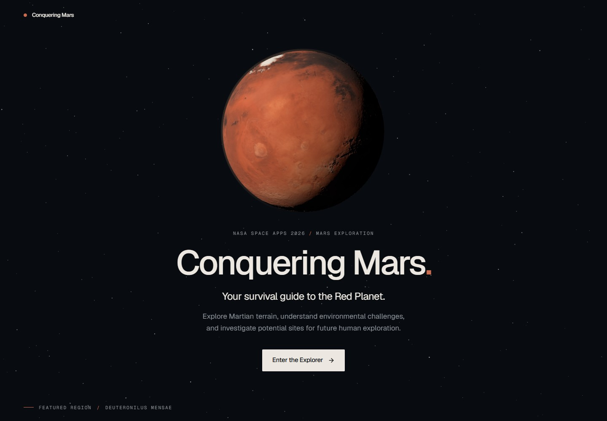
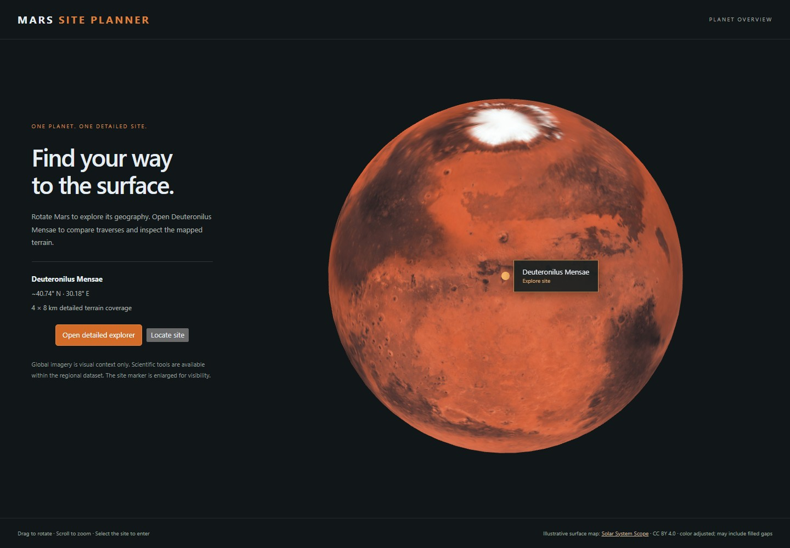
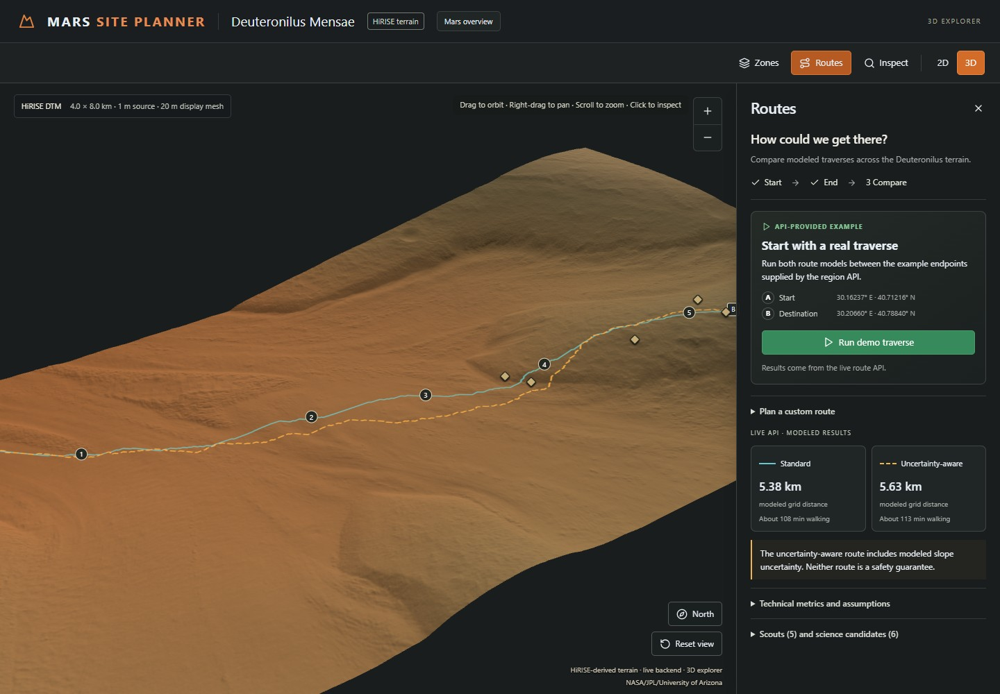
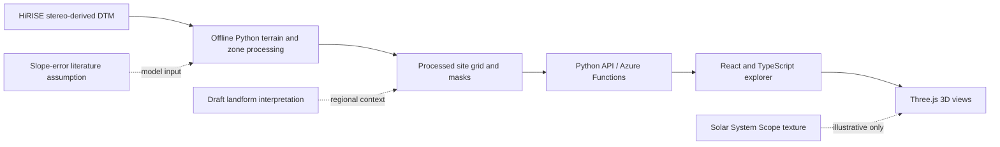

# Conquering Mars — NASA Space Apps 2026

### Make the blind spots part of the plan.

**A terrain-first Mars site planner that makes uncertainty visible before a traverse or habitat decision.** Explore the whole planet for context, then inspect real HiRISE-derived terrain at Deuteronilus Mensae.

<p align="center">
  <a href="https://polite-moss-07414eb0f.3.azurestaticapps.net"><strong>Launch the live demo →</strong></a>
</p>

## The challenge

Mars exploration decisions start with incomplete maps. A route that looks clear on a nominal terrain model may cross steep or poorly constrained ground, while candidate infrastructure sites depend on assumptions about slope, roughness, sunlight, and resource access.

**Conquering Mars** turns one high-resolution orbital terrain model into an interactive regional planning view. It compares a standard A* route with an uncertainty-aware alternative, maps six candidate infrastructure uses, and surfaces terrain conditions and scout points that deserve closer inspection.

**The impact:** teams can see how uncertainty changes a plan, investigate where the models disagree, and keep missing measurements visible. These outputs are exploration decision support—not certified routes, confirmed discoveries, or a NASA safety assessment.

## See the application

Screenshots below were captured from the deployed application on November 15, 2026. The route comparison uses the live API and its supplied example traverse.

<p align="center">
  
</p>

<p align="center"><em>Welcome — an editorial entry point to the exploration workflow.</em></p>

<p align="center">
  
</p>

<p align="center"><em>Whole-Mars overview — geographic context; the globe texture is illustrative, not a scientific map.</em></p>

<p align="center">
  
</p>

<p align="center"><em>Habitat Finder — real site terrain and API-computed example routes, with five scout points and six geometric science candidates.</em></p>

## What it does

- **Explore terrain in 3D.** Orbit a downsampled elevation mesh derived from the Deuteronilus HiRISE terrain grid. The mesh is for display; point measurements use the scientific grid.
- **Compare six infrastructure zones.** Habitat, landing, ice access, greenhouse, data center, and solar masks show nominal and uncertainty-robust areas under stated rules.
- **Compare two A* routes.** The standard route uses nominal traversability. The uncertainty-aware route penalizes modeled blindspots and can trade distance for reduced exposure to cells where the model is sensitive to slope uncertainty.
- **Inspect a location.** Read terrain elevation, slope and its modeled uncertainty, and distance to a draft interpreted landform.
- **Prioritize follow-up.** Scout markers identify high-gap cells on the standard route. Science candidates mark geometric features such as outcrops, knobs, depressions, and rough patches; they are candidates, not confirmed discoveries.

## Data provenance and attribution

The deployed scientific view uses the processed Deuteronilus site data and documented derivations. The whole-planet artwork is separated from the scientific inputs.

| Class | Resource | Resolution / scale | Role in this project | Attribution and limits |
|---|---|---|---|---|
| Scientific dataset | [HiRISE DTM DTEEC_041222_2210_040787_2210_A01](https://hirise.lpl.arizona.edu/dtm/ESP_041222_2210) · [PDS DTM file](https://hirise.lpl.arizona.edu/PDS/DTM/ESP/ORB_041200_041299/ESP_041222_2210_ESP_040787_2210/DTEEC_041222_2210_040787_2210_A01.IMG) | 1.001733 m source posts; ~10.017 m analysis cells; 20 m display mesh | Elevation, shaded relief, slope, roughness, modeled traversability, route costs, and zone masks for a 4 × 8 km crop | NASA/JPL-Caltech/UArizona. A stereo-derived orbital DTM, not ground truth; the display mesh is downsampled. |
| Scientific imagery | [HiRISE orthoimage ESP_041222_2210_RED_C_01](https://hirise.lpl.arizona.edu/dtm/ESP_041222_2210) · [PDS orthoimage file](https://hirise.lpl.arizona.edu/PDS/DTM/ESP/ORB_041200_041299/ESP_041222_2210_ESP_040787_2210/ESP_041222_2210_RED_C_01_ORTHO.JP2) | ~1.002 m pixel spacing | Visual reference for the draft landform interpretation; not a live explorer layer or a source of measured ice | NASA/JPL-Caltech/UArizona. Source imagery informs morphology only. |
| Research reference | [Sutton et al. (2022), *Revealing active Mars with HiRISE digital terrain models*](https://www.mdpi.com/2072-4292/14/10/2403) | No raster resolution | Basis cited for the assumed 0.3 m elevation-error term used to model slope uncertainty | A literature-based assumption, not a site-calibrated error measurement. The independent-pixel error model is a simplifying assumption and may overstate uncertainty. |
| Derived interpretation | [Draft ice-rich landform interpretation](api/mars-blindspots/data/deuteronilus/zones.json) | Digitized against native HiRISE imagery; applied on the ~10 m site grid | Morphology-based draft polygons used for distance-to-landform estimates and ice-access zone rules | AI-assisted draft pending team review; it is not a measurement. |
| Research reference | [Plaut et al. (2009), radar evidence for ice in lobate debris aprons](https://agupubs.onlinelibrary.wiley.com/doi/10.1029/2008GL036379) | Regional radar study; no site raster | Context for investigating ice-rich landforms in Deuteronilus Mensae | No SHARAD track crosses this DTM crop; the paper does not verify the mapped polygons or confirm local ice. |
| Research dataset | [Baker & Carter (2023), Deuteronilus Mensae ice-content data](https://doi.org/10.5281/zenodo.7753745) | Published regional samples; no raster scale applied here | Regional research context only; not an input to point values, masks, or routes | CC BY 4.0; attribution required. The documented nearest sample is about 77 km outside this DTM footprint. |
| Illustrative asset | [Solar System Scope Mars texture](https://www.solarsystemscope.com/textures/) | 2K global texture | Decorative globe texture on the welcome and whole-Mars overview screens | Solar System Scope, CC BY 4.0. Color-adjusted and may include filled gaps; visual context only, never scientific coverage or analysis data. |

No SWIM ice-consistency raster, MOLA terrain grid, local radiation product, soil dataset, or temperature dataset is used by the deployed Habitat Finder. The older Arcadia work under `archive/` is historical and is not part of this application's data flow.

## Scientific integrity and limitations

| Evidence class | What the application says |
|---|---|
| **Orbital terrain data** | Elevation and relief come from the HiRISE DTM. The orthoimage informs the draft morphology interpretation. These are remotely sensed products, not in-situ measurements. |
| **Modeled estimates** | Slope uncertainty, traversability, route costs, scout priorities, zone areas, and terrain-only sunlight are derived using documented assumptions. Zone survival percentages and route blindspot shares are model sensitivities, not probabilities. |
| **Unknown measurements** | Soil, radiation, temperature, local water/ice presence, resource accessibility, and overall habitability remain unavailable or unverified. Unknown is not zero. |

**Ice is not confirmed.** The mapped lobes are a draft morphology interpretation. Regional radar research motivates investigation, but there is no SHARAD track across the analyzed crop and no local ice measurement in the application.

**Solar masks have a known inconsistency.** The robust solar mask contains 4,324 cells outside the nominal mask because the variants used different sunlight thresholds. Its displayed area ratio is therefore not a valid survival fraction; the stored masks and values have not been silently corrected.

Routes are provisional grid paths; estimated walk time assumes 50 m/min. The uncertainty-aware mode is a comparative model, not a safety guarantee. Sunlight is terrain-only and excludes dust and atmospheric effects.

## How it is built



**Verified stack:** React 18, TypeScript 5.6, Vite 5, Three.js 0.187, Zod 4, Python 3.11, NumPy, SciPy, and Pillow. Azure Static Web Apps serves the UI and managed Python Functions API; the repository’s GitHub Actions workflow runs checks and builds/deploys on `main` when the Azure token is configured.

## Run locally

Requirements: Node.js 20+ and Python 3.11+.

```powershell
# Terminal 1 — real-data API
cd api/mars-blindspots
python -m pip install -r requirements.txt
python -m backend.dev_server

# Terminal 2 — UI; proxies API requests to localhost:7071
cd ui
npm ci
npm run dev:live
```

Open `http://localhost:5173`. Normal development uses the real Python API; `npm run dev:mock` is an explicit synthetic fixture mode for UI work and is not scientific validation.

## Checks and deployment

Run from the repository root:

```powershell
python -m pip install -r api/functions/requirements.txt
python -m pytest -q api/mars-blindspots
python -m pytest -q api/functions
npm --prefix ui test
npm --prefix ui run build
```

For end-to-end API checks, start the real API and Vite server, then run `npm --prefix ui run test:live`. Deployment configuration, required Azure secret, and smoke-check steps are in [docs/DEPLOYMENT.md](docs/DEPLOYMENT.md). More on the data and methods: [TECHNICAL_SPEC.md](TECHNICAL_SPEC.md), [integration validation](docs/DEUTERONILUS_INTEGRATION.md), and [raw-data provenance](api/mars-blindspots/data/RAW_DATA.md).

## Team and credits

Team members: **Thant Syn Htet**, **Isabella Wu**, **Allison Kim**, and **Swetha Janarthanan**. No roles or institutional affiliations are inferred here.

HiRISE data credit: **NASA/JPL-Caltech/UArizona**. The project was built for **NASA Space Apps 2026**; NASA acknowledgment identifies data provenance and does not imply NASA endorsement. The overview texture is by Solar System Scope under CC BY 4.0.
