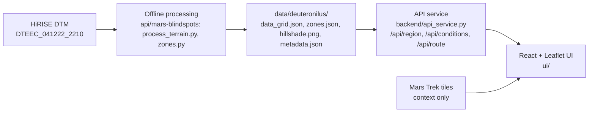

<!-- Current integration decisions supersede earlier deployment proposals. -->
# Mars Site Planner — Technical Specification

**Status:** the UI (`ui/`) and the API (`api/mars-blindspots/backend/`) run
end to end on real HiRISE data for Deuteronilus Mensae. Azure deployment is
not done yet. The earlier Arcadia Planitia work is archived, unused, in
`archive/arcadia/`.

## 1. Project overview

### What it is

A 2D web app for one walking-scale exploration site on Mars (a few km across,
built from a high-resolution terrain model). It answers two questions and is
honest about where the map can't be trusted ("blindspots"):

1. **Where can we build?** Toggleable zones for six uses: Habitat / base,
   Landing pad, Ice access, Greenhouse / crops, Data center / heavy
   infrastructure, Solar array. Each zone shows the area that passes its rule
   with nominal slope, and how much **survives** when slope is taken at its
   worst case (slope + uncertainty). Robust ground is drawn solid; ground lost
   to blindspots is drawn faint.
2. **How do we compare provisional scouting routes?** The user places a start and an end. The app
   plans two routes and compares them: a **Standard Route** (trusts the map)
   and an **Uncertainty-aware Route** (wire key `safe`) (plans on worst-case traversability and avoids
   uncertain cells). Numbered **scout points** mark the biggest blindspots on
   the standard route; **science targets** near either route are shown.

Clicking anywhere on the site opens a **Conditions** card (elevation, slope ±
uncertainty, soil, ice, radiation, temperature).

### Demo story (5 minutes)

1. Open on the site: shaded relief with Habitat, Landing pad, and Ice zones on.
2. "Solid survives our uncertainty; faint is what a naive map would promise."
   Point at a zone's nominal → robust area and survival %.
3. Try the demo traverse: two routes appear. The uncertainty-aware route is a little longer
   but cuts critical-blindspot exposure. Read the one-line comparison.
4. Hover a scout point: "this is where to send a scout before walking."
5. Click the ground: the Conditions card, with estimated/regional labels.

### Principles

- **Uncertainty is the product.** Every zone and route is shown under nominal
  and worst-case assumptions. Percentages are sensitivities under stated
  assumptions, not probabilities.
- **Honest labels.** Modeled values are *estimated*; coarse orbital values are
  *regional*; ice-rich ground is a *draft interpretation*; routes are
  exploration aids, not certified paths.
- **Null means unknown, never zero.**
- **Less on screen.** Map + one side panel; the Conditions card appears only on click.

### Non-goals

- Certifying a site or route as safe. Whole-planet analysis. 3D rendering.
- Accounts, authentication, databases, microservices, Docker.
- Hex grids, build/route mode switching, oxygen estimates, escape routes.

## 2. Architecture



- **Offline processing** (Allison, `api/mars-blindspots/`): slope, slope
  uncertainty, traversability, zones and sunlight from the HiRISE DTM, written
  to `data/deuteronilus/`. Runs once; the outputs are committed.
- **API service** (`backend/api_service.py`): loads those files once, then
  serves the three endpoints. Zones are read from `zones.json` as-is (never
  recomputed). Routes run Allison's `backend/routing.py` per request. No web
  framework: `handle(path, query)` returns status, type and bytes, so it can be
  wrapped by Azure Functions later. Locally, `backend/dev_server.py` serves it.
- **Frontend** (`ui/`): validates every response against the contract and never
  re-implements zones or routing.
- **Hosting (not done):** Azure Static Web Apps for `ui/`; the API as Python
  Azure Functions wrapping `api_service.handle`.

## 3. Site and coordinates

- **Site: Deuteronilus Mensae** (decided): mesas, ice-rich debris aprons,
  scarps and plains within a few km, so every zone type and the safe-vs-standard
  route have something to show.
- **Data:** HiRISE DTM DTEEC_041222_2210_040787_2210_A01 (NASA/JPL/University of
  Arizona), 1 m/px. A 4.0 × 8.0 km crop, bounds 40.678–40.814°N,
  30.140–30.229°E, analysed on a 10 m grid (400 × 800 cells). Relief 1,207 m.
- Body: Mars, IAU 2000 sphere. Planetocentric latitude, east-positive longitude
  in −180…180. GeoJSON order `[lon, lat]`.
- Cell ↔ lon/lat is linear in `metadata.bounds`, row 0 = north. Images
  (basemap, masks) cover `region.bounds` exactly, row 0 = north.
- Leaflet uses its `EPSG4326` CRS object because Mars Trek tiles use the same
  2×1 tiling. The data is Mars; never label it EPSG:4326 in data files.

## 4. Data and equations

Implemented in `api/mars-blindspots/` (details: its `docs/ARCHITECTURE.md`):

- Slope θ = arctan‖∇z‖. Slope uncertainty σθ = (√2·σz / 2Δ)/(1 + ‖∇z‖²), with
  σz = 0.3 m (Sutton et al. 2022), treated as independent per pixel (likely an
  overestimate). Worst-case slope θw = θ + σθ.
- Two labelled scales: **walking** (Δ = 1 m, σθ ≈ ±11°) for routes, scouts and
  the Conditions card; **footprint** (Δ = 10 m, σθ ≈ ±1.2°) for zones.
- Traversability T = logistic((20° − θ)/3°) · logistic((2 m − roughness)/0.5)
  · rock factor; Tw = T at θw. Blindspot gap = T − Tw; **critical** if > 0.5
  (shown as "more than 50 pts").
- Ice-rich ground: hand-digitized flow lobes, a **draft interpretation pending
  team review**, not a measurement.

| Conditions card value | Source | Label |
|---|---|---|
| Elevation | DTM, 10 m cell mean | — |
| Slope ± σθ | walking scale, 10 m cell mean | — |
| Ice | distance to the nearest draft ice-rich lobe (0 = on it) | *est.* |
| Soil, radiation, temperature | **not available yet** (shown as "—") | — |

## 5. Zones

Read from `zones.json` (rules in `zones.py ZONE_CONFIG`; thresholds are
assumptions). A cell is **nominal** if its footprint passes with θ and
**robust** if it also passes with θw. Area numbers are `nominal → robust km²`;
`survivesPct = robust / nominal`, a sensitivity, not a probability.

| Zone | Nominal → robust km² | Main criteria |
|---|---|---|
| Habitat / base | 4.18 → 1.27 | slope ≤ 5°, roughness ≤ 0.3 m, Tw ≥ 0.8, ≥ 200 m from scarps |
| Landing pad | 1.98 → 0.39 | slope ≤ 5°, roughness ≤ 0.2 m, ≥ 1 km from the chosen base |
| Ice access | 2.65 → 2.37 | within 200 m of ice-rich ground, slope ≤ 15° |
| Greenhouse / crops | 3.38 → 1.35 | slope ≤ 5°, winter sun ≥ 90%, near habitat and ice access |
| Data center / heavy infrastructure | 4.66 → 1.63 | slope ≤ 5°, ≥ 100 m from ice, ≥ 200 m from scarps |
| Solar array | 2.43 → 1.85 | slope ≤ 10°, top-quartile annual sunlight |

Mask PNG encoding: grayscale; 0 = fails, 100 = nominal only (lost to
blindspots), 255 = robust. The UI tints each mask with the layer color.

**Known data issue (solar):** the robust solar mask recomputes its sunlight
threshold on worst-case ground (1.098 vs 1.106), so 4,324 cells (0.43 km²) are
robust without being nominal and solar's 76% survival is inflated. Needs a fix
in `zones.py` (tracked by an expected-failure test).

## 6. Routes

Allison's `backend/routing.py`, both A* searches 8-connected on the 10 m grid:

- **Standard:** step cost = move / (T + 0.01); walls where T < 0.05.
- **Safe:** same, on SAFE = max(0.01, Tw / (1 + 5·gap)).
- Metrics: distance, walk time at 50 m/min, % of path cells with a critical
  blindspot, mean worst-case traversability.
- Scout points: 3–5 largest-gap cells (gap > 0.1) on the standard route, spaced
  along it. Science candidates: geometric (outcrop, knob, depression, rough
  patch) within 200 m of either route, at most 6.
- Reference (demo traverse, cell 600,100 → 150,300): standard 5,383 m, 7.7%
  critical; safe 5,634 m, 3.0%.
- Speed: about 5 s per request in pure Python (see Open Questions).

## 7. API contract

**Source of truth:** `ui/src/api/schema.ts` (zod). `npm run contracts` (in
`ui/`) exports JSON Schema and example responses to `contracts/`. The Python
API validates its output against `contracts/*.schema.json` in
`backend/tests/test_api_service.py`. To change the contract: edit `schema.ts`,
run `npm run contracts`, then update the API.

| Method and path | Query | Returns |
|---|---|---|
| `GET /api/region` | — | Site metadata, bounds, data badge, basemap URL, zone layers (areas, survival, mask URL), demo traverse, sources |
| `GET /api/conditions` | `lon`, `lat` | Elevation, slope (+ uncertainty), soil, ice (consistency % or distance m), radiation, temperature, each with a qualifier (`regional`, `estimated`, or null) |
| `GET /api/route` | `from=lon,lat`, `to=lon,lat` | `computeMs`, standard and safe routes, scout points, science targets |
| `GET <asset URLs>` | — | PNGs referenced by `region` (same origin, or CORS-enabled) |

Errors: `{ "error": { "code": "...", "message": "..." } }`. 400 for missing or
invalid parameters and `OUT_OF_REGION`; 500 for unexpected failures. A valid
route request with no path returns 200 with `status: "unavailable"`.

The UI shows the backend's error message directly, and reports a contract
mismatch with the failing field path (e.g. `layers.0.color`).

## 8. Frontend

- **Header:** name, site subtitle, data badge (`real` green / `mock` orange).
- **Map (left):** shaded relief, zone overlays, routes (standard solid blue,
  safe dashed green), START/END, numbered scout points, science targets,
  legend bottom-left, Conditions card top-right on click.
- **Zone symbols:** each use has one symbol (habitat = house, landing pad =
  rocket, ice access = droplet, greenhouse/crops = sprout, data center =
  server, solar = sun), set by the API's `layers[].icon`. Symbols appear on the
  toggles, the map legend, the "Suitable for" row of the Conditions card, and
  on the map inside each enabled zone's two largest robust patches (pins that
  land together are spread in a row).
- **Side panel (right):** Buildable zones (toggles + areas + survival),
  Route planner (Start → End → Compare steps, Place start / Place end / Clear,
  Try a demo traverse, status line, two route cards, one-line comparison).
  Hovering a route card highlights its line.
- **Phone:** map on top, panel below.
- **Development:** `npm run dev:live` proxies `/api` to the Python API on
  port 7071 (real data). `npm run dev:mock` explicitly uses the built-in mock backend
  (`ui/src/mocks/`, synthetic terrain at the same location), useful for UI work
  without Python. Either way the UI uses its real fetch + validation path.

## 9. Repository structure

```text
ui/                          # React + Vite + Leaflet
  src/api/                   # schema.ts (contract), client.ts
  src/map/ src/panels/       # UI
  src/mocks/                 # dev-only mock backend (not in the production bundle)
contracts/                   # generated JSON Schema + example responses
api/mars-blindspots/         # Allison's processing, zones, routing, data
  backend/api_service.py     # the three endpoints
  backend/dev_server.py      # local server on :7071
archive/arcadia/             # archived Arcadia Planitia work, unused
TECHNICAL_SPEC.md
```

## 10. Running locally

```powershell
# Terminal 1: API (numpy, scipy, pillow: see api/mars-blindspots/requirements.txt)
cd api/mars-blindspots
python -m backend.dev_server

# Terminal 2: UI
cd ui
npm install
npm run dev:live            # http://localhost:5173 with real data
```

Tests: `python -m pytest -q tests backend/tests` in `api/mars-blindspots/`;
`npm test` in `ui/`.

## 11. Remaining work

| Item | Notes |
|---|---|
| Azure deployment | Wrap `api_service.handle` in Python Azure Functions; SWA for `ui/` |
| Route speed | ~5 s per request; precompute the demo traverse or speed up A* |
| Conditions gaps | Soil, radiation, temperature not yet available (Allison's `site_conditions` task) |
| Solar mask | Fix the robust threshold in `zones.py` |
| Basemap imagery | `imagery.png` does not line up with the DTM; the hillshade is used |
| Label review | Ice = draft interpretation; σθ = modeled bound; not a safety assessment |

**Stretch:** Azure OpenAI "site pitch" summarizing a clicked point from its
conditions; key stays server-side, no new numbers invented.

## 12. Scientific and engineering rules

- Every displayed value traces to the DTM, a documented computation, or a
  citation, and appears in `sources`.
- Never invent measurements or turn missing values into zero; unknown shows "—".
- Survival percentages and blindspot shares are sensitivities, not probabilities.
- σθ is a modeled bound (constant σz, independent errors). Label it.
- Ice-rich ground is a draft interpretation. Routes are exploration aids, not
  certified paths. This is decision support, not a NASA safety assessment.
- One implementation of zones (`zones.py`) and routing (`routing.py`).

## 13. Testing

- `ui/`: contract tests run the mock backend through the schemas; client tests
  cover validation errors, error envelopes and network failure.
- `api/mars-blindspots/`: Allison's zone and routing tests, plus
  `backend/tests/test_api_service.py`: every response validates against
  `contracts/`, zone areas and the demo route match the handoff reference
  values, masks are valid PNGs, robust ⊆ nominal (solar expected to fail), and
  errors use the envelope.

## Open questions

1. **Route speed:** precompute popular traverses, or optimize A* (e.g.
   scikit-image `route_through_array`)? It must stay identical to `routing.py`.
2. **Two slope scales:** the Conditions card shows the walking-scale slope
   (±11°). Also show the 10 m footprint slope that zones use?
3. **Missing conditions:** source for soil, radiation and temperature at this
   site, or drop those tiles for the demo?
4. **Azure:** SWA managed Python functions vs. a standalone Function App (route
   time and package size with numpy/scipy).

## Integration decisions and verification

See `docs/DEUTERONILUS_INTEGRATION.md`. Python `backend/api_service.py` is the
sole active backend. Runtime routing is retained from the working teammate API
as explicitly requested for interactive starts/destinations; offline terrain and
zone processing remain unchanged. Arcadia Phase 6.2, its Typescript API, audit
records and reproducibility tests are archived under `archive/arcadia/`, not
started or deployed by the current app. Earlier archive documents describe the
former architecture and are historical.

Normal Vite dev/live/preview use the real Python API at 127.0.0.1:7071 unless
configured otherwise. Only explicit mock mode serves synthetic fixtures.
Deuteronilus request validation and A* endpoint/corner checks are preserved,
provenance is inspectable in the UI, missing measurements remain null, and
`safe` is labeled uncertainty-aware/provisional. Solar's known nonsubset masks
are flagged without altering stored masks, areas or thresholds.

No Azure deployment or resource provisioning was performed. A Python Functions
wrapper, hosting/runtime configuration, CI secrets, production smoke checks and
major-version dependency security remediation remain follow-up work.
