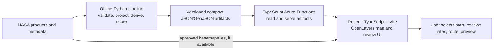

# Mars Habitat Finder — Technical Specification

**Status:** implementation guide for the 24-hour MVP. This document describes
both the current scaffold and planned work; a planned capability is not
evidence that a service, dataset, or scientific result already exists.

## 1. Project overview

### Problem and proposed solution

Exploring candidate Mars habitat locations requires comparing environmental
evidence that comes from different datasets, has different coverage, and may
have substantial uncertainty. Mars Habitat Finder will present a small set of
candidate locations alongside source provenance, suitability reasoning,
evidence confidence, and explicit review limitations. It is a decision-support
and exploration tool, not a site certification system.

### Core innovation

The MVP combines map-based exploration with traceable evidence and separates
**site suitability** (how well a site meets declared habitat criteria) from
**evidence confidence** (how complete and reliable the supporting evidence is).
Users can inspect the reasons and limitations before considering a provisional
scouting route and conceptual habitat preview.

### MVP goals

- Let a user set a starting location and explore two or three candidate sites.
- Show suitability factors, evidence confidence, source provenance, missing
  data, and radiation-review state separately.
- Support human review, optional comparison, a clearly provisional route, and a
  conceptual habitat/greenhouse preview.
- Keep all scientific outputs traceable to versioned input products and
  processing/scoring versions.

### Non-goals

- Certifying a site, astronaut safety, landing feasibility, or a route as safe.
- Real-time scientific raster processing in the Functions API.
- A general-purpose GIS, mission planner, or planetary terrain renderer.
- Accounts, authentication, database, microservices, or a custom data platform.
- Detailed habitat engineering, construction plans, or physically validated
  greenhouse design.

### User workflow

1. Select a starting point on the Mars map or choose a supplied start location.
2. Explore two or three candidate sites; inspect each marker and its data
   coverage.
3. Review suitability by factor and its explanation, separately review
   evidence confidence and radiation-review status, and inspect sources.
4. Human-review the evidence and optionally compare candidate sites.
5. Request/view a provisional scouting route from the start to a candidate;
   inspect warnings and route provenance.
6. Preview a conceptual habitat and greenhouse at the selected site, with a
   visible conceptual-only label.

## 2. System architecture



**Runtime boundary:** The Python pipeline runs locally or in a build job,
outside the deployed request path. It ingests verified NASA products, performs
geospatial preparation, and emits small versioned JSON/GeoJSON artifacts for
the API deployment. It does not expose an online service. Azure Functions
serves precomputed records, validates request parameters, and returns
consistent HTTP responses. It does not download rasters or calculate scores,
confidence, radiation, or routes during requests. The browser renders the map,
displays API results, and owns transient user selections; it does not become a
second implementation of scientific scoring.

Use JSON for API resources and GeoJSON-shaped geometry for spatial features.
Deploy the Vite build and Functions API through Azure Static Web Apps (SWA),
using the SWA `/api` path. The actual SWA workflow, supported Functions runtime,
and artifact packaging are not configured yet and must be verified before
relying on deployment behavior. Do not package large source rasters with the
Functions app.

## 3. Subsystems and boundaries

| Subsystem | Responsibilities and inputs | Outputs | Dependencies / boundary |
|---|---|---|---|
| NASA ingestion and geospatial processing | Select verified NASA products; inspect metadata, units, coverage, nodata, resolution, and coordinate reference; use Rasterio/NumPy/PyProj to normalize and derive per-site observations. | Versioned observations, coverage/quality metadata, provenance, compact artifacts. | Offline Python pipeline; selected datasets, licenses, CRS decisions. No API-time raster work. |
| Habitat suitability scoring | Apply one declared, versioned set of criteria/weights to eligible environmental observations; report per-factor contributions and missing inputs. | Numeric score on a published scale, status, explanation, algorithm version. | Implement once in Python pipeline; criteria and weights require agreement. Never infer missing values. |
| Evidence-confidence evaluation | Evaluate evidence coverage, age, resolution, quality flags, uncertainty, and source traceability. | Qualitative level and factorized rationale, with an insufficient-evidence state. | Python pipeline; independent from suitability score. No fabricated probability. |
| Radiation and environmental safety review | Summarize available radiation and other safety-relevant observations, coverage, and applicable review criteria. | Review status, evidence, caveats, and explicit human-review requirement. | Pipeline prepares evidence; no safety certification or unsupported pass/fail. Threshold authority is unresolved. |
| Scouting route generation | If time and valid terrain/obstacle data permit, create a route from user start to candidate using declared constraints and costs. | GeoJSON LineString, distance/assumptions, warnings, status `provisional`. | Pipeline/offline route computation preferred; never describe as safe or navigationally certified. Exact execution boundary TBD. |
| Mars map and site-analysis UI | Show Mars basemap, start selection, candidate markers, comparison, factor evidence, source links, review status, and route warnings. | User selections and map/review views; API requests. | React, TypeScript, Vite, OpenLayers; consumes contract only. No scientific calculations. |
| Habitat visualization | Place a conceptual habitat/greenhouse illustration or simple overlay at selected site. | Clearly labeled conceptual preview. | Frontend assets/geometry; no engineering or environmental validation implied. |
| Azure API and deployment | Serve candidate/site/route JSON, validate inputs, expose errors, bundle the current precomputed artifact set, publish UI and API. | Same-origin SWA application and `/api` responses. | TypeScript Azure Functions and SWA; no database, auth, microservices, or scientific runtime. |

## 4. Shared data contracts

### Current contract and target evolution

The repository currently has `api/src/contracts/site.schema.json` and matching
TypeScript types. Its `GET /api/sites/{id}` response contains one placeholder
site, five factor records, nullable suitability/confidence, source entries, and
a placeholder route. It does **not** yet model scientific observation details,
uncertainty, coordinate reference metadata, algorithm versions, radiation
review, or source-product provenance. Extend this contract deliberately before
publishing scientific data; do not silently change fixture semantics. Add a
`schemaVersion` in the first scientific-data contract release and keep the
JSON Schema as the wire contract source of truth. TypeScript interfaces and
Python serialization must conform to it. Additive optional fields are
backward-compatible; renaming/removing fields or changing units/meaning
requires a versioned breaking change and coordinated frontend update.

### Coordinate conventions

- Geometry is GeoJSON-shaped; coordinate order is `[longitude, latitude]`.
- The existing `[0, 0]` fixture coordinate is synthetic and must never be
  displayed as an actual Mars observation.
- Mars is not Earth WGS84. Every scientific location and route must carry an
  explicit Mars body, longitude direction/range, latitude convention,
  coordinate reference/datum, and angular or linear units. Do not label Mars
  values as EPSG:4326 or apply Earth transformations by assumption.
- Reproject only through a documented Mars CRS definition and tested
  transformation. The exact datum, longitude convention, and map projection
  remain open decisions (see Open Questions).

### Shared target record

The following is a shape example, not scientific data. Null means unknown or
unavailable; it never means zero. Any `placeholder` record must be visibly
identified in the UI and excluded from scientific ranking.

```json
{
  "schemaVersion": "1.0.0",
  "id": "candidate-example",
  "name": "Candidate example",
  "dataStatus": "placeholder",
  "location": {
    "type": "Point",
    "coordinates": [0, 0],
    "coordinateReference": {
      "body": "Mars",
      "datum": "TBD",
      "longitudeDirection": "TBD",
      "latitudeType": "TBD",
      "units": "degrees"
    }
  },
  "observations": [
    {
      "id": "observation-example",
      "factor": "water",
      "variable": "TBD",
      "value": null,
      "unit": null,
      "uncertainty": null,
      "status": "not-assessed",
      "sourceIds": []
    }
  ],
  "suitability": {
    "status": "not-assessed",
    "score": null,
    "scale": "0-100",
    "explanation": [],
    "algorithmVersion": null
  },
  "evidenceConfidence": {
    "status": "not-assessed",
    "level": null,
    "rationale": [],
    "probability": null
  },
  "radiationReview": {
    "status": "not-assessed",
    "observationIds": [],
    "summary": "No radiation safety conclusion is available."
  },
  "sources": [
    {
      "id": "source-example",
      "provider": "TBD",
      "product": "TBD",
      "productVersion": null,
      "uri": null,
      "accessedAt": null,
      "processingVersion": null
    }
  ]
}
```

Contract rules:

- Observation `factor` identifies a domain (water, terrain, solar, thermal,
  radiation); `variable` names the actual measured/derived quantity. Store a
  numeric value only when backed by a source; include its unit (prefer a
  consistent machine-readable unit vocabulary) and uncertainty when provided
  by the product or derivation. Keep quality flags, spatial/temporal support,
  and source IDs with observations as the selected dataset requires.
- Observation status: `observed`, `derived`, `not-assessed`,
  `insufficient-evidence`, or `placeholder`. Null value/unit is permitted only
  for non-observed statuses; a real zero is numeric zero with provenance.
- Suitability score is nullable until assessed. If populated, use the agreed
  0–100 normalized scale, publish the algorithm version, factor breakdown,
  weights/criteria summary, and missing-input treatment. Do not compare scores
  across algorithm versions without an explicit compatibility rule.
- Confidence is a qualitative `low`, `medium`, or `high` level, or null with a
  status/reason. It represents evidence support, not probability, suitability,
  or safety. `probability` remains null unless a calibrated probabilistic model
  is later explicitly approved and validated.
- Radiation review status is one of `not-assessed`, `insufficient-evidence`,
  `review-required`, or `reviewed`. `reviewed` means evidence was reviewed; it
  does not mean safe or certified.
- Each source ID resolves to provider, product name/identifier, product
  version, URI/catalog identifier, access date, and pipeline processing
  version. Preserve license/attribution terms and source-specific quality
  metadata when available.
- Route geometry is GeoJSON LineString using the same explicit Mars coordinate
  reference as site points. Include route status, start/site IDs, length and
  unit if computed, assumptions, warnings, source/artifact version, and
  generation version. Empty geometry is allowed only with an explanatory
  unavailable status.

## 5. API contract

All endpoints return `application/json`; successful resources include a
`schemaVersion`. The Functions app uses the standard `/api` prefix. Candidate
data is a read-only snapshot of packaged pipeline artifacts. No request should
trigger ingestion or scientific computation.

| Method and path | Status | Request | Success response |
|---|---|---|---|
| `GET /api/sites` | Planned | Optional `limit` and opaque `cursor` only if pagination is needed; MVP may return all 2–3 sites. | `{ "schemaVersion": "1.0.0", "sites": [CandidateSite...] }` |
| `GET /api/sites/{id}` | **Implemented scaffold** | Path `id`. | Current response `{ "site": CandidateSite }` from one in-memory placeholder fixture; future scientific contract adds `schemaVersion`. |
| `GET /api/routes?startId=...&siteId=...` | Planned | Required `startId`, `siteId`; identifiers resolve against known starts/sites. | `{ "schemaVersion": "1.0.0", "route": Route }`; provisional only, or an explicit unavailable response. |

For the MVP, route requests should resolve only to known, precomputed
start/site pairs. If no matching route artifact exists, return the documented
unavailable route state. Arbitrary on-demand pathfinding is outside the API
runtime boundary and should be cut under deadline pressure.

Current `GET /api/sites/{id}` is an Azure Functions Node.js v4 anonymous HTTP
trigger (`route: sites/{id}`). It returns HTTP 200 for
`placeholder-site-001`, and HTTP 404 for an unknown ID using
`{ "error": { "code": "SITE_NOT_FOUND", "message": "..." } }`. The existing
smoke test calls the handler directly; it does not verify the live Functions
host. The other endpoints, CORS configuration, SWA hosting, and real artifact
loading are not implemented.

For all endpoints, use consistent errors:

```json
{ "error": { "code": "INVALID_ARGUMENT", "message": "Human-readable explanation." } }
```

Use HTTP 400 for invalid/missing required query parameters, 404 for unknown
site/start IDs, and 500 for unexpected server/artifact failures. Do not expose
stack traces. If route data is unavailable, return a documented 200 route
resource with `status: "unavailable"` when the request is valid; use 404 only
when a referenced site/start does not exist. Add CORS only if local development
uses different origins; deployed SWA should use same-origin `/api` paths.

## 6. Repository structure

### Current repository (observed)

```text
README.md
.gitignore
api/
  host.json
  package.json
  package-lock.json
  tsconfig.json
  README.md
  src/
    index.ts
    contracts/site.ts
    contracts/site.schema.json
    fixtures/sites.ts
    functions/get-site.ts
  test/get-site.test.ts
pipeline/
  README.md
  requirements.txt
```

There is no frontend, NASA data, pipeline source, scoring implementation,
routing implementation, deployment workflow, or configured Azure environment
in the repository today.

### Minimal target structure

```text
ui/                         # React/Vite app; owned by Developer 1
  src/{app,map,sites,contracts}/
pipeline/                   # Python offline processing; owned by Developer 2
  src/{ingest,geospatial,observations,suitability,confidence,routing}/
  config/                   # dataset and algorithm configuration
api/                        # TypeScript Functions; owned by Developer 2
  src/{functions,contracts,data}/
  test/
TECHNICAL_SPEC.md
```

The pipeline emits a compact versioned artifact set into a deployment/build
staging location consumed read-only by the API. Keep large raw rasters outside
the repository and API bundle. The frontend owns view state and presentation;
the pipeline owns scientific derivations; the API owns transport and
validation. Maintain one JSON Schema and generate or validate language types
from it where practical.

## 7. Developer responsibilities and integration

**Developer 1 — Frontend, UI, map, Azure deployment:** build React/TypeScript/
Vite shell; OpenLayers Mars map; start selection; candidate list/detail and
comparison; provenance/confidence/radiation presentation; route and conceptual
preview states; consume only the agreed API contract; configure SWA UI/API
deployment and environment URLs. Do not duplicate scoring logic.

**Developer 2 — NASA data, science, API, routing:** select and verify a small
number of NASA products; build offline Python ingestion/geospatial processing;
own the authoritative suitability and confidence implementation; prepare
radiation evidence/review states; create route only if valid inputs and time
permit; evolve the TypeScript Azure Functions API to serve versioned artifacts
and the specified endpoints.

**Shared checkpoints:**

1. Agree on coordinate reference and JSON Schema before map/API integration.
2. Agree on candidate IDs, factor names/units/statuses, score scale, null
   semantics, and error shape; commit one representative schema-valid fixture.
3. Developer 2 publishes a versioned artifact and endpoint responses; Developer
   1 renders that artifact without local scientific calculations.
4. Jointly verify the integrated UI labels placeholders, uncertainty, missing
   data, radiation-review caveats, and route provisional status honestly.
5. Developer 1 completes SWA deployment and live smoke checks; Developer 2
   confirms the deployed API artifact/version matches the tested science output.

## 8. Development roadmap (24-hour scope)

| Phase | Priority and dependency | Deliverable / exit check |
|---|---|---|
| 1. Foundation | P0; current scaffold exists. | Contract, module boundaries, runnable API smoke/build, local instructions. |
| 2. NASA dataset ingestion | P0; requires agreed CRS and product choice. | One or two verified products read offline; metadata, units, coverage, quality, and source provenance captured; small reproducible site observations. |
| 3. Suitability and confidence | P0; depends on phase 2 and declared criteria. | One authoritative implementation; nullable outputs for insufficient evidence; rationale and algorithm version; unit/scientific checks. |
| 4. Frontend/API integration | P0; can begin with fixture while phase 2 proceeds, then switch to validated artifact. | Map, select start/site, detail evidence panels, human review, robust loading/empty/error states. |
| 5. Routing and habitat preview | P1; route requires usable terrain/constraints; preview can use a static conceptual asset. | Provisional route with warnings if feasible; otherwise honest unavailable state. Conceptual preview labeled clearly. |
| 6. Testing, Azure deployment, submission | P0; depends on integrated MVP. | Unit/integration/science checks, deployed SWA UI/API smoke test, source attribution, demo path and known limitations. |

Start the map and contract-driven UI in parallel with dataset validation. Reserve
time for integrated browser testing and deployment. Cut features in this order
if time slips: animation/3D detail, site comparison, route calculation (show an
unavailable/provisional explanation), then dynamic habitat placement (show a
static labeled concept). Do not cut provenance, missing-data states, caveats,
or the distinction between suitability and confidence. Limit the scientific
scope to a few candidate sites and a small validated set of products.

## 9. Scientific and engineering constraints

- Use only verified NASA observations/products for scientific claims; record
  product IDs, versions, units, coverage, quality, and attribution.
- Never invent measurements, interpolate silently, turn missing values into
  zero, or fabricate confidence probabilities. Show missing/insufficient
  evidence explicitly.
- Suitability and evidence confidence are separate outputs with separate
  explanations and validation. Neither is a safety judgment.
- Radiation must be reviewed where evidence exists. A missing dataset or
  review never implies low radiation or a safe site. Thresholds require an
  authoritative source and explicit approval.
- Routes are provisional exploration aids, not certified safe, traversable, or
  operational navigation paths. Display assumptions and warnings.
- Keep one authoritative implementation of scoring and confidence logic in
  the offline Python pipeline. The API serializes results; the UI explains
  them.
- Version datasets, pipeline, algorithm, and contract. Preserve enough
  provenance to reproduce each derived result.
- No database, authentication, microservices, Docker, or additional
  infrastructure in the MVP. Keep the API read-only and artifact-backed.
- Do not expose synthetic fixture coordinates or fixture values as real Mars
  observations.

## 10. Testing and definition of done

### Minimum tests

- **Unit:** Python tests for nodata/units/coordinate transforms, observation
  extraction, missing-input behavior, score explanations/weight handling,
  confidence status, radiation-review status, and route constraints if routed.
  TypeScript tests for query/path validation, response/error mapping, and
  artifact lookups. Frontend tests for selecting a site and displaying
  placeholder, missing, and review caveats.
- **Contract/integration:** validate every pipeline artifact against the shared
  JSON Schema; test each endpoint for valid records, unknown IDs, invalid
  parameters, empty/unavailable route, and stable error envelopes; exercise
  frontend against a local Functions host or recorded schema-valid fixture.
- **Scientific validation:** verify input provenance and transformations;
  hand-check selected site observations against source metadata/known product
  values; test explicit nodata and uncertainty cases; review score sensitivity
  and confidence rationale; ensure no result is emitted as assessed without
  required inputs. Document limitations instead of claiming validation beyond
  tested evidence.
- **Deployment:** build UI/API, deploy to SWA, smoke-test UI and `/api` from the
  deployed origin, verify artifact/schema version and source attribution, and
  inspect browser console/network failures.

### Definition of done

The demo can follow the complete workflow with a small, schema-valid candidate
set; every scientific value is sourced or visibly unavailable; score,
confidence, and radiation review are distinct; users can inspect human-readable
reasoning and provenance; route/preview are either honestly provisional and
conceptual or explicitly unavailable; local tests pass; and the deployed SWA
experience has been smoke-tested. If verified scientific input is unavailable,
ship a clearly labeled non-scientific UI/API fixture and do not claim scientific
site assessment.

## Open Questions

Resolve these at the first shared checkpoint; they affect both developers and
must be settled before real scientific locations are rendered:

1. Which Mars coordinate reference, datum, longitude direction/range, latitude
   convention, and map projection will the pipeline and OpenLayers use? How
   will it be represented alongside GeoJSON coordinates?
2. Which small set of NASA products will be used, what are their exact product
   identifiers/licenses/units/coverage, and which 2–3 candidate locations can
   they support?
3. What habitat criteria, weights, score scale, and missing-data policy define
   suitability? This document proposes a 0–100 scale but no formula.
4. What evidence-quality rules define low/medium/high confidence? It must
   remain qualitative unless calibration data supports probabilities.
5. Which authoritative radiation evidence and review thresholds are in scope,
   and who can approve the wording? No site-safety cutoff is assumed here.
6. Is route generation feasible with available terrain/obstacle data, what
   start constraints/costs apply, and should it run offline or be computed on
   request from precomputed inputs?
7. What UI basemap source/projection and deployment origin/configuration are
   available, and does the chosen SWA setup support the intended Functions
   runtime and artifact packaging?
8. Will the target scientific contract be version 1.0.0 as shown, and will
   TypeScript types be generated from the JSON Schema or validated against it
   in CI?
