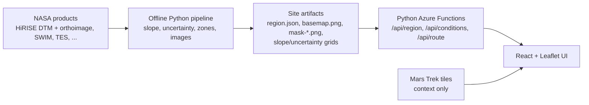

# Mars Site Planner — Frontend Specification

**Status:** design and data contract for the new frontend in `ui/`. Backend phase notes live in `../TECHNICAL_SPEC.md`. This document
describes planned work. A planned capability is not evidence that a dataset,
service, or scientific result already exists.

## 1. Project overview

### What it is

A 2D web app for one walking-scale exploration site on Mars (a few km across,
built from a high-resolution terrain model). It answers two questions and is
honest about where the map can't be trusted ("blindspots"):

1. **Where can we build?** Toggleable zones for six uses: Habitat / base,
   Landing pad, Ice access, Greenhouse / crops, Data center / heavy
   infrastructure, Solar array. Each zone shows the area that passes its rule
   with nominal slope, and how much **survives** when slope is taken at its
   worst case (slope + uncertainty). Robust ground is drawn solid; ground lost
   to blindspots is drawn faint.
2. **How do we get there safely?** The user places a start and an end. The app
   plans two routes and compares them: a **Standard Route** (trusts the map)
   and a **Safe Route** (plans on worst-case traversability and avoids
   uncertain cells). Numbered **scout points** mark the biggest blindspots on
   the standard route; **science targets** near either route are shown.

Clicking anywhere on the site opens a **Conditions** card (elevation, slope ±
uncertainty, soil, ice, radiation, temperature).

### Demo story (5 minutes)

1. Open on the site: shaded relief with Habitat, Landing pad, and Ice zones on.
2. "Solid survives our uncertainty; faint is what a naive map would promise."
   Point at a zone's nominal → robust area and survival %.
3. Try the demo traverse: two routes appear. The Safe Route is a little longer
   but cuts critical-blindspot exposure. Read the one-line comparison.
4. Hover a scout point: "this is where to send a scout before walking."
5. Click the ground: the Conditions card, with estimated/regional labels.

### Principles

- **Uncertainty is the product.** Every zone and route is shown under nominal
  and worst-case assumptions. Percentages are sensitivities under stated
  assumptions, not probabilities.
- **Honest labels.** Modeled values are *estimated*; coarse orbital values are
  *regional*; ice-rich ground is a *draft interpretation*; routes are
  exploration aids, not certified paths.
- **Null means unknown, never zero.**
- **Less on screen.** Map + one side panel; the Conditions card appears only on click.

### Non-goals

- Certifying a site or route as safe. Whole-planet analysis. 3D rendering.
- Accounts, authentication, databases, microservices, Docker.
- Hex grids, build/route mode switching, oxygen estimates, escape routes.

## 2. Architecture



- **Offline pipeline** (`pipeline/`): reads the site DTM, derives slope and a
  per-pixel slope uncertainty, evaluates the six zone rules under nominal and
  worst-case slope, writes zone masks and the shaded-relief basemap, and records
  provenance. Runs locally, not in the request path.
- **Functions API** (`api/`): serves `region` from the artifacts, samples
  `conditions` at a point, and runs the two A* searches for `route` on request.
- **Frontend** (`ui/`): React + Vite + Leaflet. Validates every response
  against the contract and never re-implements scoring or routing.
- **Hosting:** Azure Static Web Apps with the Functions API at `/api`.

## 3. Site and coordinates

- One site, a few km across (mock: 4 × 8 km at 20 m/px). The site must be
  covered by a HiRISE DTM (see Open Questions).
- Body: Mars, IAU 2000 sphere, radius 3,389.5 km. Planetocentric latitude,
  east-positive longitude in −180…180. GeoJSON order `[lon, lat]`.
- Images (basemap, masks) cover `region.bounds` exactly, row 0 = north,
  equirectangular in lon/lat (resample the DTM's native projection to this).
- Leaflet uses its `EPSG4326` CRS object because Mars Trek tiles use the same
  2×1 tiling. The data is Mars; never label it EPSG:4326 in data files.

## 4. Data layers

| Layer | Source | Used for | Label |
|---|---|---|---|
| Elevation, slope | HiRISE DTM (~1 m/px), resampled | Zones, routing, conditions | — |
| Slope uncertainty | DTM error estimate (see Open Questions) | Worst case, blindspots | — |
| Basemap | Shaded relief from the DTM | Display | — |
| Ice-rich ground | SWIM + apron mapping | Ice access, distance to ice | *estimated* (draft) |
| Soil | TES thermal inertia | Habitat, data center | *regional* |
| Radiation | Model from elevation, anchored to MSL RAD | Conditions | *estimated* |
| Temperature | Model | Conditions | *estimated* |
| Context | NASA Mars Trek tiles | Background outside the site | — |

**Definitions:**
- Traversability `T(s) = clamp(100 × (1 − s/25°), 0, 100)`.
- Worst-case slope `s_wc = s + 2σ`; worst-case traversability `T_wc = T(s_wc)`.
- Blindspot points = `T − T_wc`. A **critical blindspot** is > 50 points.

## 5. Zones

Each zone has a rule. A cell is **nominal** if it passes with `s`, **robust**
if it also passes with `s_wc`. Area numbers are `nominal → robust km²`;
`survivesPct = robust / nominal × 100`. Initial rules (tunable, versioned):

| Zone | Rule |
|---|---|
| Habitat / base | slope < 6°, within 1.2 km of ice, off mesas, not loose sand |
| Landing pad | slope < 3°, ≥ 600 m from mesas/scarps, not on ice |
| Ice access | ice-rich ground, slope < 15° |
| Greenhouse / crops | slope < 8°, within 800 m of ice |
| Data center / heavy infrastructure | slope < 5°, firm ground, within 2 km of ice |
| Solar array | slope < 10°, flat or south-facing |

Mask PNG encoding: grayscale; 0 = fails, 1–127 = nominal only (lost to
blindspots), 128–255 = robust. The UI tints each mask with the layer color.

## 6. Routes

Two A* searches (8-connected) over the site grid, same endpoints:

| | Standard | Safe |
|---|---|---|
| Uses | nominal `T` | worst-case `T_wc` |
| Slope > 25° | impassable | impassable |
| Slope > 15° | cost × 10 | cost × 10 |
| Base cost | `1 + (100 − T)/100` | `1 + 1.2 (100 − T_wc)/100` |
| Blindspot penalty | none | + 4 if critical, else proportional |

Per route: distance, estimated walk time (hiking-speed model from grade),
critical-blindspot share of the path, length-weighted mean worst-case
traversability. Scout points: up to 5 largest blindspots (≥ 30 pts) on the
standard route, ≥ 200 m apart, numbered in path order. Science targets: those
within 350 m of either route.

## 7. API contract

**Source of truth:** `ui/src/api/schema.ts` (zod). `npm run contracts` (in
`ui/`) exports JSON Schema and example responses to `contracts/`. The Python
API should validate its output against `contracts/*.schema.json` in tests.

| Method and path | Query | Returns |
|---|---|---|
| `GET /api/region` | — | Site metadata, bounds, data badge, basemap URL, zone layers (areas, survival, mask URL), demo traverse, sources |
| `GET /api/conditions` | `lon`, `lat` | Elevation, slope (+ uncertainty), soil, ice %, radiation, temperature, each with a qualifier (`regional`, `estimated`, or null) |
| `GET /api/route` | `from=lon,lat`, `to=lon,lat` | `computeMs`, standard and safe routes, scout points, science targets |
| `GET <asset URLs>` | — | PNGs referenced by `region` (same origin, or CORS-enabled) |

Errors: `{ "error": { "code": "...", "message": "..." } }`. 400 for missing or
invalid parameters and `OUT_OF_REGION`; 500 for unexpected failures. A valid
route request with no path returns 200 with `status: "unavailable"`.

The UI shows the backend's error message directly, and reports a contract
mismatch with the failing field path (e.g. `layers.0.color`).

## 8. Frontend

- **Header:** name, site subtitle, data badge (`real` green / `mock` orange).
- **Map (left):** shaded relief, zone overlays, routes (standard solid blue,
  safe dashed green), START/END, numbered scout points, science targets,
  legend bottom-left, Conditions card top-right on click.
- **Side panel (right):** Buildable zones (toggles + areas + survival),
  Route planner (Start → End → Compare steps, Place start / Place end / Clear,
  Try a demo traverse, status line, two route cards, one-line comparison).
  Hovering a route card highlights its line.
- **Phone:** map on top, panel below.
- **Development:** the Vite dev server runs a mock backend at `/api`
  (`ui/src/mocks/`), so the UI always uses its real fetch + validation path.
  Set `API_PROXY_TARGET=http://localhost:7071` to use the Python API instead.

## 9. Repository structure

```text
ui/                     # React + Vite + Leaflet (Developer 1)
  src/api/              # schema.ts (contract), client.ts
  src/map/ src/panels/  # UI
  src/mocks/            # dev-only mock backend (not in the production bundle)
contracts/              # generated JSON Schema + example responses
api/                    # TypeScript Functions (Arcadia phases, see TECHNICAL_SPEC.md)
api/mars-blindspots/    # Python Blindspots backend (Deuteronilus Mensae)
pipeline/               # offline Arcadia processing
docs/                   # this spec, FRONTEND_HANDOFF.md, methodology
TECHNICAL_SPEC.md       # backend phase notes
```

**Integration status:** the UI's contract (`contracts/`) does not yet match
either backend on `main`. `api/` serves the Arcadia phase endpoints described
in `docs/FRONTEND_HANDOFF.md` (`/api/sites`, `/api/starts`, `/api/routes`, …).
`api/mars-blindspots/` has the Deuteronilus terrain, zones and routing that this
design is based on, but not these three endpoints. The team needs to pick which
backend serves `/api/region`, `/api/conditions` and `/api/route` (see Open
Questions).

## 10. Roles and checkpoints

**Developer 1 — Frontend and deployment.** **Developer 2 — Data, pipeline, API.**
Checkpoints: (1) contract agreed (done: `contracts/`); (2) pipeline produces a
real `region.json` + images; (3) UI switched to the live `region`;
(4) live `conditions` and `route`; (5) label review and demo rehearsal.

## 11. Sprint plan (20 hours)

| Hours | Work | Exit check |
|---|---|---|
| 1–4 | UI on mock backend (done); choose site + DTM; pipeline reads DTM, slope | Real slope grid for the site |
| 4–10 | Uncertainty, zones, masks, basemap → `/api/region` | Real zones in the UI |
| 10–15 | Two-route A*, scout points → `/api/route`; `/api/conditions` | Real routes in the UI |
| 15–20 | Labels, provenance, deploy, rehearse | Deployed 5-minute demo |

**Cut order:** science targets → solar and data-center zones → conditions
temperature/radiation. Do not cut the nominal-vs-robust distinction, the safe
route, or honesty labels.

**Stretch:** Azure OpenAI "site pitch" summarizing a clicked point from its
conditions; key stays server-side, no new numbers invented.

## 12. Scientific and engineering rules

- Use only verified NASA products for real data; record product IDs, versions,
  URLs, and access dates; return them in `sources`.
- Never invent measurements or turn missing values into zero.
- Survival percentages and blindspot shares are sensitivities, not probabilities.
- Routes are exploration aids, not safe or certified paths.
- One implementation of zones (pipeline) and routing (API).

## 13. Testing and definition of done

- UI (done): contract tests run the mock backend through the schemas; client
  tests cover validation errors, error envelopes, and network failure.
- Python: slope on a synthetic tilted plane; worst-case mask ⊆ nominal mask;
  safe route has ≤ critical-blindspot share of standard on a synthetic grid
  with an uncertain patch; responses validate against `contracts/`.
- Deployment smoke test of all endpoints from the deployed origin.

**Done when:** the demo story runs end to end on real data, every value is
sourced or visibly unknown, labels are visible, tests pass, and the deployed
app has been smoke-tested.

## Open questions

0. **Which backend feeds this UI?** Wrap `api/mars-blindspots/` (closest match:
   Deuteronilus DTM, uncertainty, zones, dual routing) behind the three
   endpoints in §7, or adapt the UI to the Arcadia endpoints in `api/`.

1. **Site:** which HiRISE DTM? It must show ice-rich terrain for the story.
   The design reference used Deuteronilus Mensae; our earlier choice was
   Arcadia Planitia. Both have candidate DTMs to check.
2. **Uncertainty source:** per-pixel slope uncertainty from the DTM's error /
   figure-of-merit products, or estimated from image texture and shadow?
3. **Ice-rich ground:** mapped from SWIM (coarse) plus apron outlines, or
   hand-digitized for the site? Label as draft either way.
4. Resample resolution for zones/routing (mock: 20 m) vs. response time.
5. Do SWA managed Python functions allow the route computation time?
